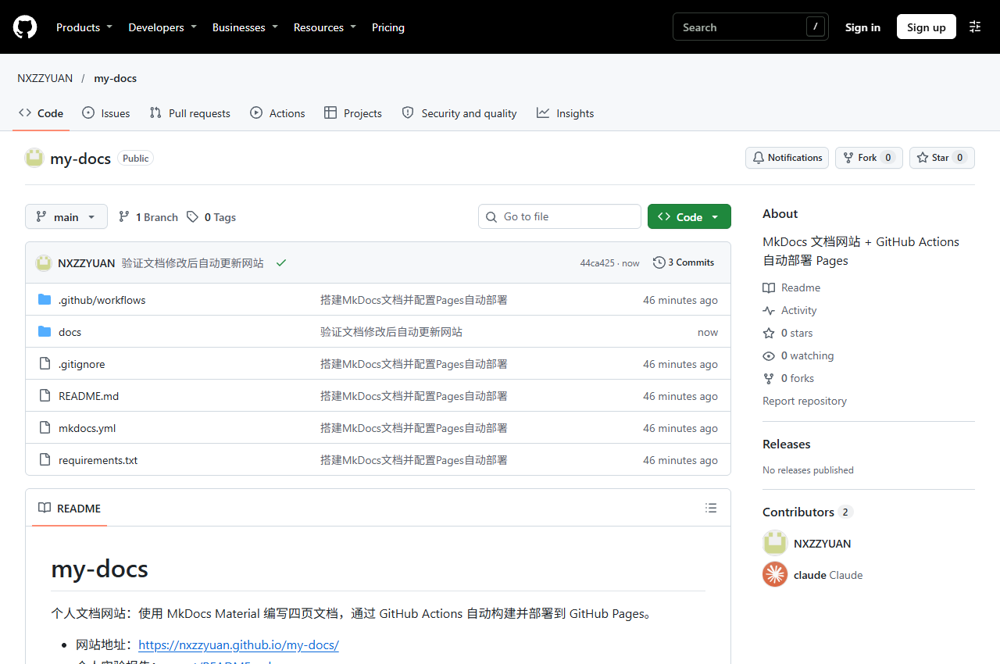
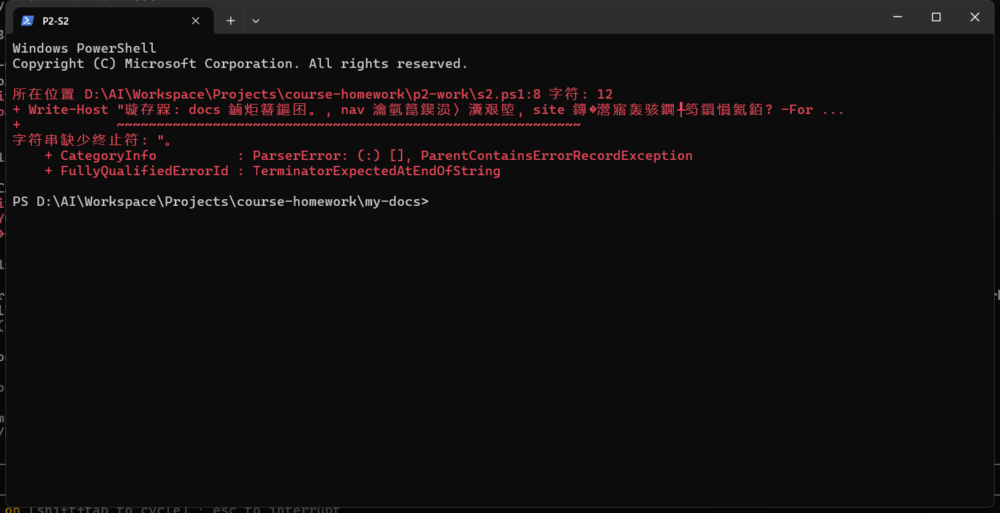
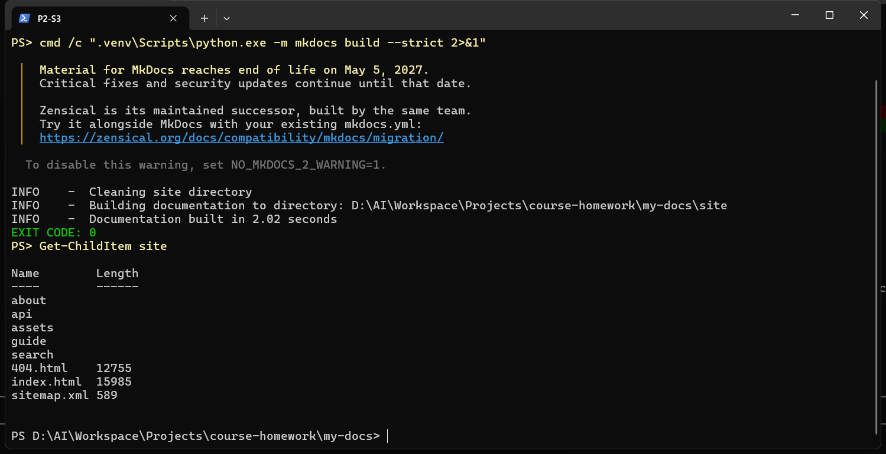
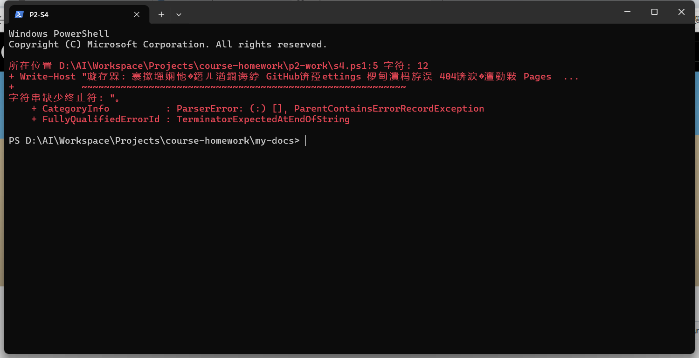
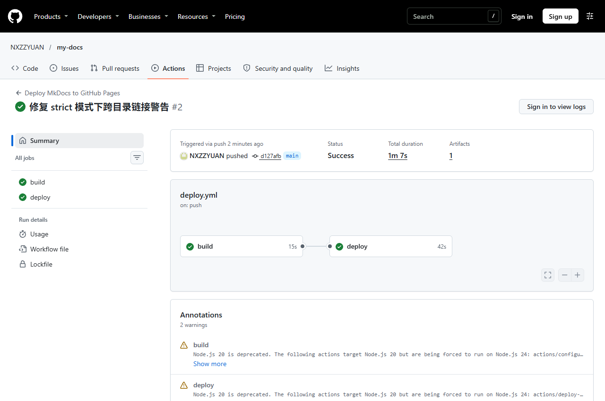
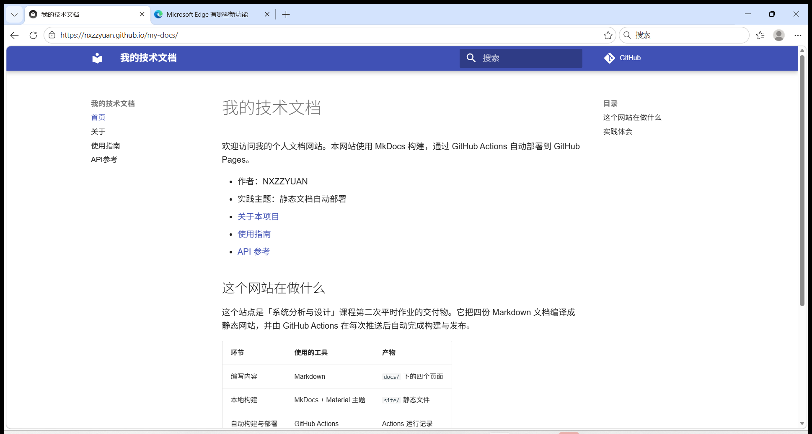
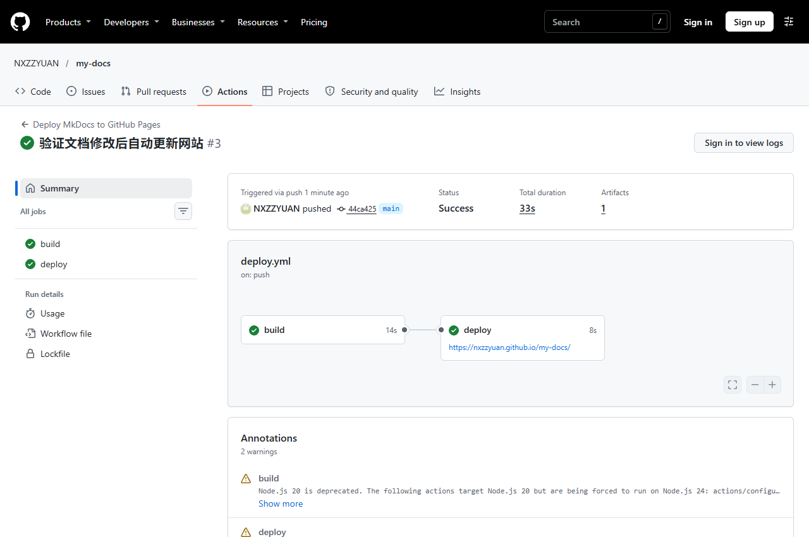
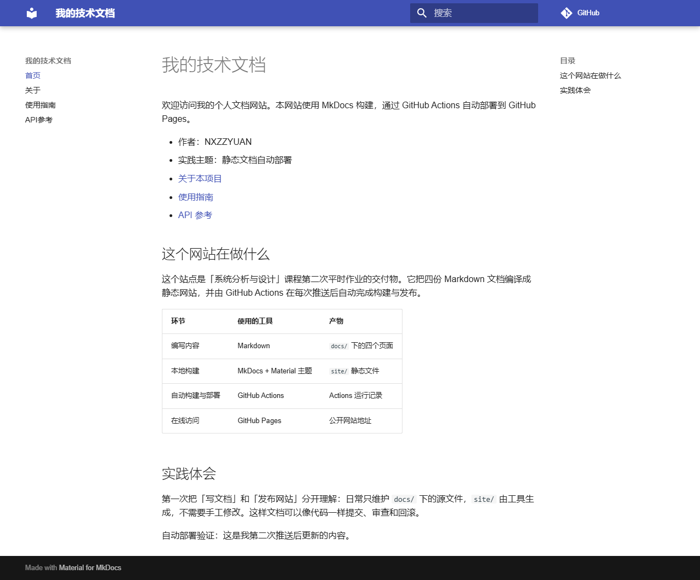

# 实践项目2：个人实验报告

## 1. 基本信息

- GitHub 登录名：NXZZYUAN
- 个人仓库地址：https://github.com/NXZZYUAN/my-docs
- 最终网站地址：https://nxzzyuan.github.io/my-docs/
- 完成日期：2026-11-23

## 2. 实践过程与关键截图

### 2.1 仓库创建

使用个人 GitHub 账号创建公开仓库 `NXZZYUAN/my-docs`，本地初始化 `main` 分支并推送首个提交。仓库所有者是个人账号，仓库为 Public，符合本次个人作业要求。



### 2.2 项目结构与 MkDocs 配置

项目按任务书要求建立 `docs/`、`report/`、`.github/workflows/` 三个目录，加上 `mkdocs.yml`、`requirements.txt`、`.gitignore` 和根 `README.md`。



- `docs/` 保存四个页面的 Markdown 源文档，是日常唯一需要修改的内容目录。
- `mkdocs.yml` 的 `nav` 决定网站导航顺序，路径相对于 `docs/`，所以写 `index.md` 而不是 `docs/index.md`。
- `site/` 是 `mkdocs build` 生成的静态网站，已经在 `.gitignore` 中排除，不需要提交，也不应手工修改。

### 2.3 本地构建或预览

本地使用 Python 3.12.10 建立独立虚拟环境，安装 `requirements.txt` 中的依赖，然后执行严格模式构建：

```powershell
python -m venv .venv
.\.venv\Scripts\python.exe -m pip install -r requirements.txt
.\.venv\Scripts\python.exe -m mkdocs build --strict
```



构建退出码为 0，`site/` 目录生成成功。检查了四页导航、表格、代码块和页面间链接，确认 `--strict` 没有警告后才推送。

### 2.4 Pages 设置

仓库的 Pages 发布来源设置为 **GitHub Actions**，没有使用 `gh-pages` 分支发布方式。



说明：截图时浏览器未登录 GitHub，`Settings → Pages` 页面返回 404，无法截取网页设置界面。上图是 `gh api repos/NXZZYUAN/my-docs/pages` 返回的实际配置：`html_url` 为 `https://nxzzyuan.github.io/my-docs/`，`build_type` 为 `workflow`，`public` 为 `true`。部署成功后 Actions 的 `github-pages` 环境正常运行，可作为同一配置的交叉证据。

### 2.5 Actions 首次构建和部署

第一次推送后，工作流在 `mkdocs build --strict` 阶段失败，日志给出的原因是：

```text
WARNING - Doc file 'about.md' contains a link '../report/README.md',
but the target is not found among documentation files.
Aborted with 1 warnings in strict mode!
```

原因是 `docs/about.md` 链接到了文档目录之外的 `report/README.md`，MkDocs 无法把它当作站点页面解析。把该链接改为纯文本说明后重新推送，第二次运行成功，`build` 与 `deploy` 均通过。



对应提交：`d127afbf0d5aecf20bb39d00c3a108ca55398534`，运行地址：https://github.com/NXZZYUAN/my-docs/actions/runs/45208101641

### 2.6 网站访问与四页导航检查

打开 `https://nxzzyuan.github.io/my-docs/`，逐一检查了四个页面：

- 首页：标题、作者、实践主题、三个页面链接和一张流程表；
- 关于：项目目标、技术组成表格和本人实践体会；
- 使用指南：操作步骤、命令代码块和页面间链接；
- API 参考：请求参数表、JSON 返回示例和错误码表。

四页导航正常，表格和代码块渲染正常，页面间链接均可点击。



### 2.7 第二次推送与自动更新验证

在 `docs/index.md` 末尾加入一句本人编写的验证文字：

```text
自动部署验证：这是我第二次推送后更新的内容。
```

提交 `44ca4250433cdc63ab3a03e2fd3f3e269d25c47c` 后，工作流由 `push` 自动触发，没有点击手动部署。第二次运行 `build` 与 `deploy` 均成功，耗时 33 秒。



- 对应提交：https://github.com/NXZZYUAN/my-docs/commit/44ca4250433cdc63ab3a03e2fd3f3e269d25c47c
- 对应 Actions 运行：https://github.com/NXZZYUAN/my-docs/actions/runs/45208368694

刷新公开网站后，新增文字出现在首页底部，证明推送后网站确实自动更新。



## 3. 问题与解决

1. **严格模式阻止了跨目录链接。** 第一次运行在 `mkdocs build --strict` 阶段失败，日志明确指出 `about.md` 链接到 `../report/README.md` 但目标不在文档集合内。解决：把该链接改成纯文本说明，报告目录仍然通过仓库入口访问。这个问题说明 `--strict` 会把警告当失败，适合在推送前发现死链。
2. **本机 git push 连接被重置。** 后续提交通过 `git push` 时出现 `Recv failure: Connection was reset`，改用 GitHub Contents API 更新单个文件，提交记录同样进入 `main` 并触发工作流。仓库内容与提交历史未受影响。
3. **浏览器未登录导致设置页无法截图。** 打开仓库 `Settings → Pages` 时返回 404，页面右上角显示 `Sign in`。改用 Pages API 的实际返回值作为配置证据，并在上文中标注了这一限制。
4. **Actions 的 Node.js 20 弃用提示。** 工作流日志出现 `Node.js 20 is deprecated` 注解，涉及 `configure-pages@v5`、`deploy-pages@v4` 等官方 Actions。这只是提示，`build` 和 `deploy` 都成功；按任务书要求没有改动工作流版本。

## 4. 原理理解

1. **`docs/` 和 `site/` 各保存什么？为什么不用手工修改 `site/`？** `docs/` 保存 Markdown 源文档和页面结构，是人工维护的输入；`site/` 是 MkDocs 按主题生成的 HTML、CSS、JS 等静态文件，是构建输出。`site/` 每次构建都会被重新生成，手工修改会在下一次构建时被覆盖，而且它已被 `.gitignore` 排除，不进入版本库。
2. **本次工作流在什么情况下自动运行？** 推送到 `main` 分支且改动涉及 `docs/**`、`mkdocs.yml`、`requirements.txt` 或 `.github/workflows/deploy.yml` 时自动运行；也可以在 Actions 页面用 `workflow_dispatch` 手动运行。
3. **`build` 与 `deploy` 两个任务有什么区别？** `build` 任务检出源码、安装 Python 依赖、执行 `mkdocs build --strict`，并把 `site/` 作为 Pages artifact 上传；`deploy` 任务依赖 `build` 成功，使用 `pages: write` 和 `id-token: write` 权限把 artifact 发布到 `github-pages` 环境。
4. **只修改 `report/README.md` 会触发部署吗？为什么？** 不会。工作流的 `paths` 过滤器只包含 `docs/**`、`mkdocs.yml`、`requirements.txt` 和工作流文件，`report/**` 不在其中；这是预期行为，报告更新不影响网站内容。
5. **本次方案为何无需创建 `gh-pages` 分支？** 官方 Pages Actions 方案通过 `upload-pages-artifact` 上传构建产物，再由 `deploy-pages` 直接发布到 Pages，部署记录由 GitHub 的 `github-pages` 环境管理，不需要再把产物提交到 `gh-pages` 分支。

## 5. 自检

- [x] 使用本人个人账号的公开仓库，没有使用组织或小组仓库。
- [x] 示例账号 `YOUR-USERNAME` 已全部替换为 `NXZZYUAN`。
- [x] YAML 使用空格缩进，工作流表达式未改动。
- [x] Pages 来源为 GitHub Actions，未混用分支发布。
- [x] 四页可访问，第二次推送的新增文字已在网站生效。
- [x] 报告截图使用相对路径，GitHub 页面可直接查看。
